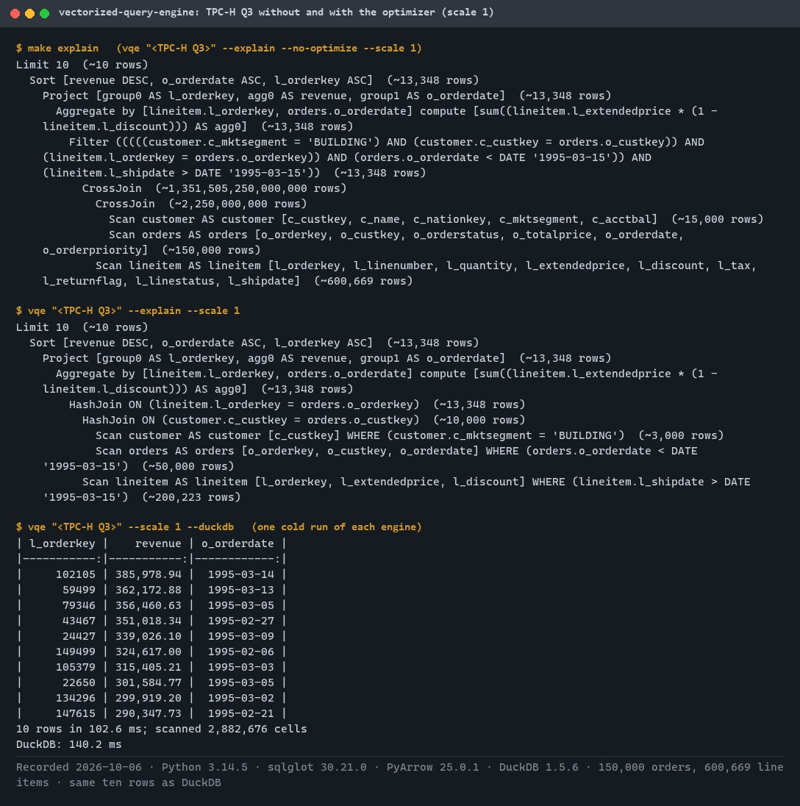
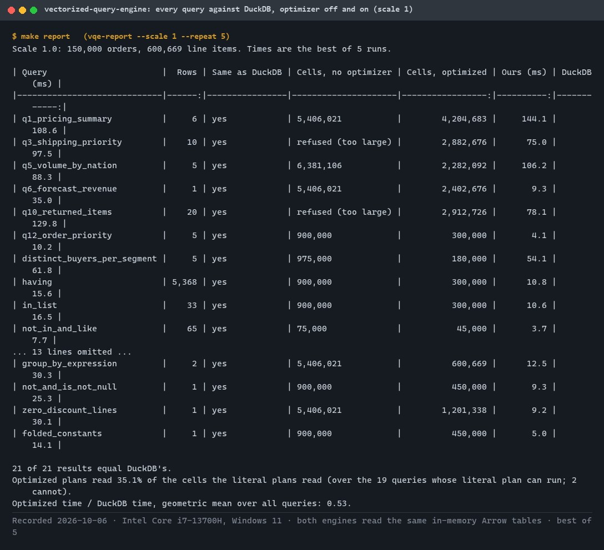
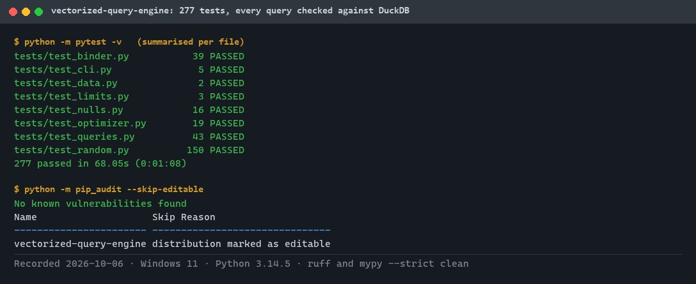
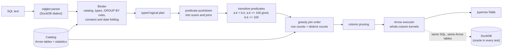
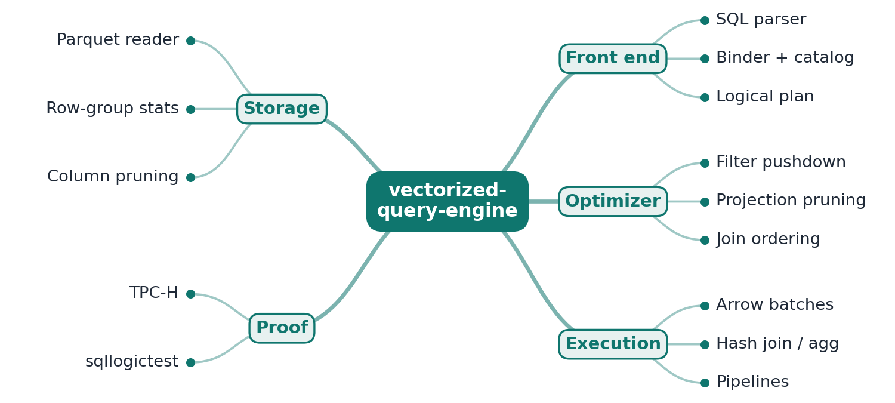
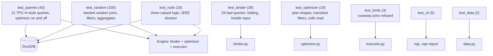

# vectorized-query-engine

[](https://github.com/EquinoxWN/vectorized-query-engine/actions/workflows/ci.yml)


> Demystifies why analytics databases are fast: a readable SQL engine on Apache Arrow with an optimizer and a vectorized executor, its results and speed checked against DuckDB.

Part of my **Data Engineering** list · Python · core project

## Proof it works

TPC-H Q3 written with comma joins is, taken literally, a filter over a cross product of 1.35 x 10^15 rows. The optimizer moves every filter into its scan, takes both join conditions out of WHERE, starts from the smallest filtered table and reads only the needed columns:



All 21 queries return exactly DuckDB's rows at scale 1. Two cannot run at all without the optimizer, and the optimized plans read 35% of the cells:



277 tests (21 TPC-H-style queries, 150 random queries and 16 NULL cases, each compared with DuckDB with the optimizer on and off) pass, and the dependency audit is clean:



## Architecture

**What M1 runs today:**



**Full roadmap (M1 to M3):**



## How it works

_Steps 1 and 2 are built and tested (M1); the rest is on the [roadmap](#roadmap)._

1. sqlglot turns SQL into an AST; a binder resolves tables and columns against a catalog and produces a logical plan.
2. Rule-based optimizations push filters down to the scan, drop unused columns and reorder joins using simple cardinality estimates.
3. The physical plan runs on Arrow record batches (thousands of rows at a time) using PyArrow compute kernels, so the vectorization comes from Arrow, not Python loops.
4. Hash join and hash aggregate are written from scratch, with spill-to-disk as a stretch goal.
5. The Parquet scan skips whole row groups using min/max statistics and reads only the columns a query needs.
6. sqllogictest files verify correctness, and TPC-H queries are timed against DuckDB on the same hardware.

## Who it helps

- **Who:** Engineers and students who want to see how analytics databases execute SQL.
- **The problem:** Engines such as DuckDB are fast but large, and hard to read end to end.
- **How to use it:** Run SQL through a small, readable engine (binder, rule-based optimizer, vectorized Arrow executor) and compare its results and timings with DuckDB on the same data.

## Tech stack

| Area | In M1 | Planned |
|---|---|---|
| Core | Python, sqlglot parser, binder, rule-based optimizer, PyArrow compute kernels and joins | Hash join and aggregate written from scratch, Parquet row-group skipping |
| Test | Every query compared with DuckDB, 150 random queries, TPC-H-style query set | sqllogictest files |
| Bench | Timed against DuckDB on the same machine | - |

Language: **Python** (3.11+). Code in [`src/vectorized_query_engine/`](src/vectorized_query_engine): `binder.py` (SQL to typed plan), `optimizer.py` (rules and estimates), `executor.py` (Arrow execution and safety limits), `queries.py` (the TPC-H-style query set), `report.py` (comparison with DuckDB).

## Run it

**Prerequisites:** Python 3.11+. DuckDB is installed with the dev extras and is only used as the reference engine.

```bash
python -m venv .venv && source .venv/bin/activate   # Windows: .venv\Scripts\activate
make setup     # install the package and dev tools
make lint      # ruff, ruff format, mypy --strict
make test      # 277 tests, every query checked against DuckDB
make explain   # TPC-H Q3's plan without and with the optimizer
make report    # all 21 queries at scale 1: equality with DuckDB, cells read, time
```

Query the generated TPC-H-shaped data yourself:

```bash
vqe "SELECT c_mktsegment, count(*) AS n FROM customer JOIN orders ON c_custkey = o_custkey GROUP BY c_mktsegment" --duckdb
vqe "SELECT ... " --explain              # the optimized plan with estimated rows per node
vqe "SELECT ... " --explain --no-optimize
```

Supported in M1: inner and cross joins (`JOIN ... ON` or comma joins with conditions in WHERE), WHERE, GROUP BY, HAVING, ORDER BY, LIMIT, `sum`, `avg`, `min`, `max`, `count`, `count(DISTINCT ...)`, arithmetic, comparisons, `AND` / `OR` / `NOT`, `IN`, `LIKE`, `BETWEEN`, `IS [NOT] NULL`, and `DATE` constants with `+`/`-` `INTERVAL`. Outer joins, subqueries, CTEs, window functions and `DISTINCT` are refused with an error that names the feature.

## Tests and results

Full numbers, the Q3 plans and the analysis: [docs/results/m1.md](docs/results/m1.md).

| Check | Result |
|---|---|
| Tests (`make test`) | **277 passed**, 0 failed |
| Same rows as DuckDB | 21 TPC-H-style queries, 150 random queries and 16 NULL-semantics queries, each with the optimizer on and off |
| Optimizer effect (scale 1) | Q3 and Q10 cannot run as written (cross product refused); optimized they finish in under 80 ms. Optimized plans read 35% of the cells the literal plans read |
| One rule, measured | transitive predicates took the self-join query from 52.9 ms to 6.3 ms (DuckDB: 23.7 ms) |
| Speed vs DuckDB (scale 1, in memory) | geometric mean 0.53 of DuckDB's time, dominated by small queries where DuckDB's fixed per-query costs show; slower on Q1 (1.3x) and Q5 (1.2x), explained in the results |
| Hostile SQL | over-long or deeply nested queries, runaway cross products and joins: a clear error, never a crash or memory exhaustion |
| Lint / audit | ruff, mypy `--strict` clean; `pip-audit`: no known vulnerabilities |

### Test map



## Roadmap

**M1** (≈15 h)
- [x] Write `docs/rfc/0001-design.md`: problem, goals, non-goals, chosen design
- [x] sqlglot turns SQL into an AST; a binder resolves tables and columns against a catalog and produces a logical plan.
- [x] Rule-based optimizations push filters down to the scan, drop unused columns and reorder joins using simple cardinality estimates.

**M2** (≈20 h)
- [ ] The physical plan runs on Arrow record batches (thousands of rows at a time) using PyArrow compute kernels, so the vectorization comes from Arrow, not Python loops.
- [ ] Hash join and hash aggregate are written from scratch, with spill-to-disk as a stretch goal.

**M3** (≈25 h)
- [ ] The Parquet scan skips whole row groups using min/max statistics and reads only the columns a query needs.
- [ ] sqllogictest files verify correctness, and TPC-H queries are timed against DuckDB on the same hardware.
- [ ] Publish the proof below with real numbers

## Proof

What this repo must show before it counts as done:

- A TPC-H table of your engine vs DuckDB, with honest analysis of where you are slower and why.

| Result | Value |
|---|---|
| M3 proof above | Not measured yet (M3). Current M1 numbers: see [Tests and results](#tests-and-results). |

## Why it matters

- **Interview angle:** 'How does a database execute a SQL query?'
- **Upstream I'd like to contribute to:** DuckDB or Apache Arrow: tests and documentation.

## Design docs

- [RFC 0001: design](docs/rfc/0001-design.md)
- [ADR 0001: record architecture decisions](docs/adr/0001-record-architecture-decisions.md)
- [ADR 0002: sqlglot front end with our own binder](docs/adr/0002-sqlglot-front-end-with-our-own-binder.md)
- [ADR 0003: rule-based optimizer with a greedy join order](docs/adr/0003-rule-based-optimizer-with-greedy-join-order.md)
- [M1 results](docs/results/m1.md)

## Scope

This is a learning and portfolio system, not a hosted production service. Everything runs locally.

## Security and contributing

- Every GitHub Action is pinned to a commit SHA; workflows run read-only, without persisted credentials.
- Dependabot update pull requests are paused (`open-pull-requests-limit: 0`) so the repository keeps a single `main` branch; dependencies are updated by hand and checked by the CI audit.
- SQL is treated as untrusted input: length and nesting limits, and cross products and joins above fixed sizes are refused before they are built; CI runs `pip-audit` on every push.
- Report vulnerabilities privately: see [SECURITY.md](SECURITY.md). To contribute, see [CONTRIBUTING.md](CONTRIBUTING.md).

## License

MIT, see [LICENSE](LICENSE).
